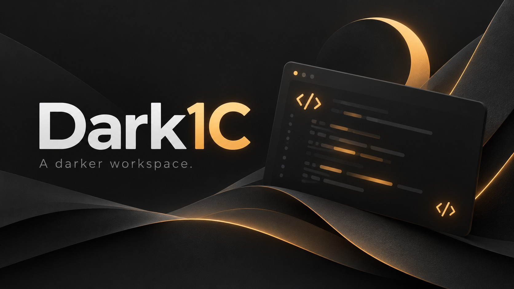

<div align="center">



# Dark1C

### Тёмная сторона Конфигуратора

Спокойные графитовые оттенки, собственный фон и привычный рабочий процесс 1С.


[](LICENSE.txt)

[Возможности](#что-уже-работает) · [Сборка](#собрать-и-запустить) · [Планы](ROADMAP.md) · [Обратная связь](https://github.com/davins526/1C-Dark-theme-configuration/issues)

</div>

---

**Dark1C** — экспериментальное оформление Конфигуратора 1С под Windows: тёмная и светлая темы.
Программа подключается к выбранному сеансу и меняет отрисовку интерфейса во время работы,
не заменяя файлы установленной платформы.

> Проверена **1С 8.5.1.1529 x64**. Другие версии пока не поддерживаются.
> Первая проверка — на копии базы: это ранняя версия, а не готовый промышленный релиз.

*Обложка — иллюстрация проекта, не скриншот интерфейса.*

## Что уже работает

| Возможность | Сейчас |
|---|---|
| Тёмное оформление | Дерево конфигурации, основные панели, меню и редактор модулей проверены на тестовой базе |
| Светлое оформление | Мягкие серые фоны и тёмный текст; фоновые изображения приглушены для читаемости |
| Настройки | Выбранная тема, включение картинки и затемнение сохраняются между запусками |
| Свой фон | Изображение на крупных фонах Cairo, включая редактор модулей; регулируемое затемнение |
| Выбор сеанса | Подключение к конкретному PID с проверкой версии, разрядности и режима DESIGNER |
| Переключение | Включение и выключение без завершения Конфигуратора |
| Исходники | C / C#, MinHook, скрипты сборки и отдельный тестовый процесс |

Покрытие интерфейса частичное. Картинка пока может появляться также в рабочей области
и других крупных областях — привязка только к редактору модулей находится в плане.

## Собрать и запустить

В репозитории опубликованы исходники. Готовые EXE/DLL в Git не хранятся.

### Требования

- Windows x64 и .NET Framework 4.x с компилятором C#.
- [Zig 0.14.1](https://ziglang.org/download/0.14.1/) для сборки нативного модуля.
- Конфигуратор **1С 8.5.1.1529 x64** для подключения.

MinHook 1.3.4 уже включён в `vendor/`. Скрипт сборки не скачивает зависимости.

```powershell
git clone https://github.com/davins526/1C-Dark-theme-configuration.git
cd 1C-Dark-theme-configuration
./build-live.ps1 -Zig C:\tools\zig.exe
./Dark1C.exe
```

1. Откройте Конфигуратор на копии базы.
2. Выберите нужный сеанс в Dark1C, сверив PID и заголовок.
   Выберите палитру «Графит» или «Светлая».
3. При желании включите картинку и настройте затемнение.
4. Нажмите **«Включить»** и дождитесь подтверждения.

Настройки изображения применяются повторным нажатием «Включить».
Профиль хранится в `%LOCALAPPDATA%\Dark1C\profile.xml`.
При обновлении с 0.1 сначала закройте подключённые Конфигураторы: протокол DLL изменён.
При отсутствии `background.png` сборка создаст нейтральный градиент.
Его можно заменить своим PNG рядом с DLL. Отдельный предпросмотр использует
необязательный файл `assets/background.jpg`.

## Отключение и ограничения

- **«Выключить»** возвращает исходные вызовы рисования. DLL остаётся в процессе
  до закрытия Конфигуратора; закрытие лаунчера само по себе эффект не отключает.
- Для обновления DLL закройте сеансы, к которым она подключалась.
- Возможны артефакты частичной перерисовки, недостаточный контраст отдельных элементов
  и изменение оттенков. Иногда требуется переоткрыть редактор.
- Системные диалоги, все конструкторы, отладка, разные DPI и длительные сеансы
  ещё не прошли полную проверку. Стандартный заголовок Windows остаётся системным.
- Лаунчер и Конфигуратор должны работать с одинаковым уровнем прав.

Программа загружает собственную DLL в процесс 1С и перехватывает функции Cairo/GDI/Win32.
Это не штатная настройка платформы: сбой модуля может повлиять на весь сеанс.
Сетевых запросов, автозапуска и обращений к данным информационной базы в текущем коде нет.

## Проверки

Проверены подключение к отдельному настоящему Конфигуратору, ввод и сохранение
тестового кода, фон и возврат светлого оформления. Автоматический тест запускает
собственный одноразовый процесс с установленным `cairo.dll`, проверяет пиксели,
фоновое изображение и OFF.

```powershell
./test-live.ps1 -Cairo 'C:\Program Files\1cv8\8.5.1.1529\bin\cairo.dll'
```

[Результаты проверок](VALIDATION.md) · [Изменения](CHANGELOG.md) · [Критерии релиза](RELEASE.md) · [Техническое описание 0.1](docs/TECHNICAL.md)

## Куда движемся

- Читаемый интерфейс во всех состояниях и стабильная перерисовка.
- Inter для поддерживаемых элементов интерфейса и JetBrains Mono для модулей.
- Собственные значки с поддержкой масштабирования.
- Профили оформления и фон только в редакторе модулей.
- Обнаружение платформ, профили совместимости и проверка других версий 1С.

Это планы, не возможности текущей сборки. [Полный roadmap →](ROADMAP.md)

## Обратная связь

Нашли светлый участок или ошибку? [Откройте issue](https://github.com/davins526/1C-Dark-theme-configuration/issues/new).
Укажите сборку 1С, Windows, масштаб экрана и шаги повторения. Перед публикацией
скриншота уберите названия баз, пароли и рабочие данные.

## Благодарности и лицензии

Источник вдохновения — [BIXXEZ / 1C-CUSTOM-theme](https://github.com/BIXXEZ/1C-CUSTOM-theme).
Его исходники изучались при предварительном аудите. Эта реализация написана отдельно
на C и C# с MinHook. Полное сравнение проектов остаётся отдельной задачей перед релизом.

Собственный код распространяется по [MIT](LICENSE.txt).
[MinHook и HDE](THIRD_PARTY_LICENSES.txt) сохраняют свои лицензии.
Пользовательские обои в репозиторий не включены. Обложка создана с помощью генерации изображений.

Dark1C — независимый проект, не официальный продукт фирмы «1С».

